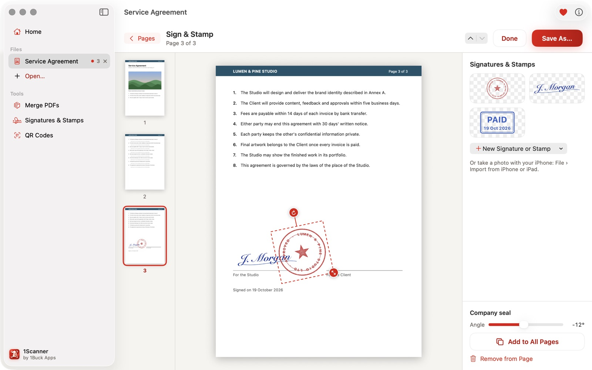
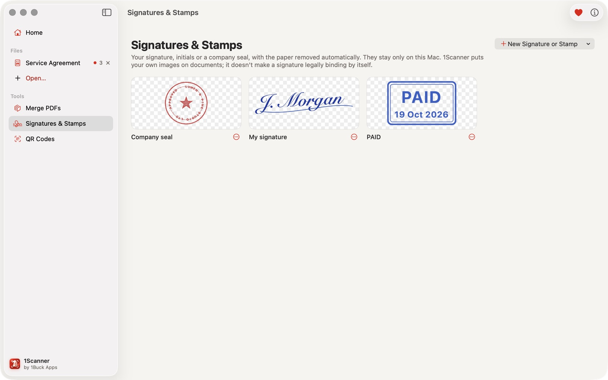
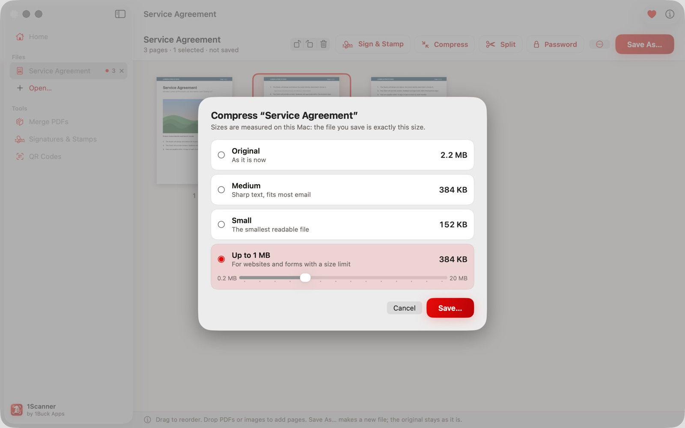
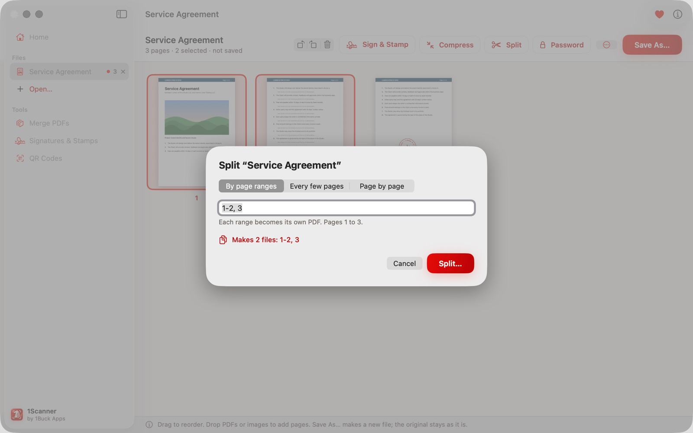
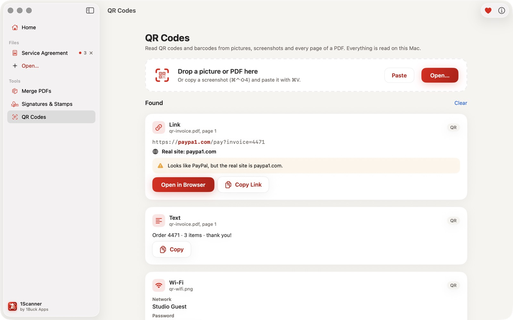

# 1Scanner for Mac

Free, open-source PDF tools for the Mac: put your own signature, initials or company seal on any page or on every
page, compress a PDF to the size a website or email asks for, split it by page ranges, merge PDFs and images,
reorder, rotate and extract pages, add or remove a password — and read QR codes and barcodes from pictures,
screenshots and PDFs.

Everything runs on your Mac. No upload, no account, no ads, no analytics, no subscription.

**Download:** [onebuckapps.com/1scanner-mac](https://onebuckapps.com/1scanner-mac/) — a DMG signed with a Developer
ID and notarized by Apple. macOS 14 or later, Apple silicon and Intel. 17 languages.



*Screenshots use made-up demo documents (`tools/make_demo_files.swift`).*

## What it does

**Signatures and stamps**
- Your signature, initials or company seal from a photo or a scan: the paper is removed and the image is cropped to
  the ink, so a red seal stays red on a transparent background
- Draw a signature with the trackpad or mouse, or take a photo with your iPhone (Continuity Camera)
- Ready stamps (APPROVED, PAID, COPY, CONFIDENTIAL, DRAFT, RECEIVED, a date or your own word) in red, blue or black
- Put one on a page, move, resize and turn it, or add it to every page at the same spot. The library stays on your Mac

A signature placed this way is a picture of your signature, not a certified electronic signature.



**Compress**
- Original, Medium or Small, or up to a size limit from 0.2 to 20 MB; the size of each option is measured before you
  save
- Only the pictures inside the PDF are scaled down, so text stays text. When a strict limit can only be met by turning
  pages into pictures, 1Scanner says so: text in that copy can't be selected or searched



**Split, merge and pages**
- Split by page ranges (`1-3, 5, 8-10`), every few pages, or page by page
- Merge PDFs and images in the order you set; images to PDF
- Reorder, rotate, delete and insert pages, extract pages as a new PDF, export pages as PNG or JPEG
- Save a copy with a password, or without it



**QR codes and barcodes** from pictures, screenshots and every page of a PDF (QR, Micro QR, Aztec, Data Matrix, PDF417
and product barcodes). Links show the real site and warn about look-alike addresses, plain http, IP addresses and
link shorteners; nothing opens by itself. Wi-Fi codes show the network and password to copy.



## How it treats your files

- **The original is never changed.** Every result is a new file where you choose, and existing files are never
  replaced.
- **Unsaved changes are never dropped silently.**
- **Nothing leaves your Mac.** The app goes online only when you ask: Check for Updates reads one small file,
  [`version.json`](https://onebuckapps.com/1scanner-mac/version.json), and Install and Relaunch downloads the new
  version from onebuckapps.com. [Privacy policy](https://onebuckapps.com/1scanner-mac/privacy/).

## Build from source

Requirements: macOS 14 or later, Xcode 16 or later. No third-party dependencies.

```bash
git clone https://github.com/eh0tka/1scanner-mac.git
cd 1scanner-mac
xcodebuild -project OneScannerMac.xcodeproj -scheme OneScannerMac -configuration Release -derivedDataPath build build
open build/Build/Products/Release/1Scanner.app
```

This builds an ad-hoc signed app that runs on your own Mac. Or open `OneScannerMac.xcodeproj` in Xcode and run the
`OneScannerMac` scheme. `tools/release.sh` builds the signed, notarized DMG (it needs a Developer ID certificate).

## Contributing

Issues and bug reports are welcome. See [CONTRIBUTING.md](CONTRIBUTING.md) before opening a pull request, and
[SECURITY.md](SECURITY.md) for anything that could damage or expose documents. [AGENTS.md](AGENTS.md) is the guide
for contributors and coding agents; [docs/PRODUCT.md](docs/PRODUCT.md) is the product contract.

## Support the developer

1Scanner for Mac is free. If it saved you time, you can [support the developer with crypto](https://onebuckapps.com/donate/).

## License

GPL-3.0: see [LICENSE](LICENSE). You may use, study, change and share the code; if you distribute a changed
version, its source must stay open under the same license.

The name "1Scanner", the 1Buck Apps name and the app icon are not covered by the license: a fork must use its own
name and icon.

`OneScannerMac/Resources/public_suffix_list.dat` is the [Public Suffix List](https://publicsuffix.org/) by Mozilla,
under the Mozilla Public License 2.0.

Made by [1Buck Apps](https://onebuckapps.com/).
